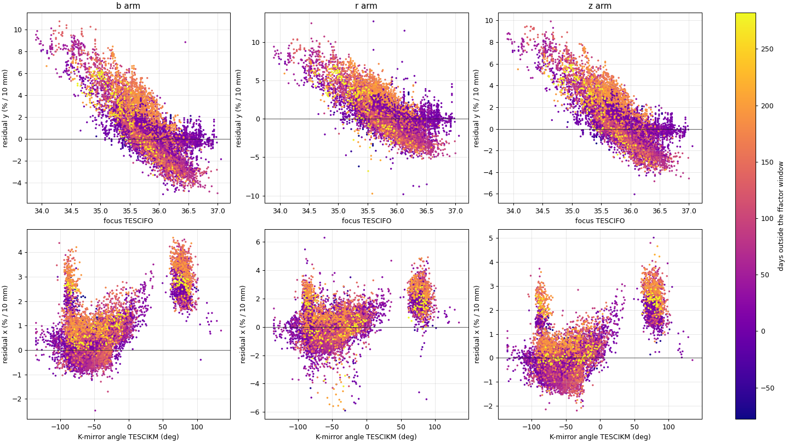

Large-Scale Flat Field
======================

These routines measure, model and correct the *large-scale* part of the
fiber flat field of the science IFU: the relative throughput of the three
spectrographs and a smooth gradient across the IFU.  They grew out of
the spectrograph asymmetries seen in the sky lines of DRP 1.3.2 data
(GitHub issue `sdss/lvmdrp#268 <https://github.com/sdss/lvmdrp/issues/268>`_),
and they work on existing lvmCFrame files, without rerunning the
pipeline.

The routines are new (November 2026).  The measurement
(``SkyLinePlane.py``) and its analysis (``SkyLinePlaneAnalysis.py``) have
been run on all 1.3.2 science exposures; the model (``FitFlatModel.py``,
``ApplyFlatModel.py``) is a working prototype.

Background
----------

**How DRP 1.3.2 builds the flat field.**  It is done in two stages:

1. *Stage 1, fiber to fiber, from the twilights.*  Each twilight flat is
   extracted and each fiber's spectrum is compared with a reference fiber.
   Before that, a plane across the IFU and three spectrograph factors are
   fitted to the twilight and removed, because the twilight sky has a
   real gradient of its own (toward the Sun and the horizon) that changes
   from exposure to exposure.  The master flat of each calibration epoch
   therefore has the right fiber-to-fiber structure, but its large-scale
   part is deliberately left undetermined.
2. *Stage 2, the large scale, from the science sky lines.*  For each
   "ffactor epoch" the science exposures of a window of about 30 nights
   are reduced with the stage-1 flats, three spectrograph factors and a
   plane are fitted to one airglow line per arm (5577, 6364, 8399 A) in
   each exposure, the fits are averaged, and the master flats of all the
   calibration epochs in that ffactor epoch are multiplied by the result.
   The values are recorded in the flat headers (``FACTOR1-3``,
   ``GCOEFF1-4``).

In 1.3.2 only the factors are multiplied into the flats; the gradient is
recorded but never applied (``run_twilights.do_ffactor_correction``).
``FixFlatGradient.py`` (see :doc:`data_quality`) applies the recorded
gradient to existing CFrames.

**What the per-exposure measurements show.**  Measuring the factors and
the plane in every science exposure (``SkyLinePlane.py``, 22,482
exposures) shows that the large-scale throughput is not fixed for an
epoch, so a correction measured once per epoch cannot be exact even
when it is applied correctly:

- The gradient follows the **telescope focus** (``TESCIFO``): about
  -4% per 10 mm per unit of focus along y.  The same slope is found from
  the focus changes within a night, so this is the focus and not the
  season.  Focus ranges over about 34-37, so this term alone moves the
  gradient by more than the whole recorded gradient.
- It follows the **K-mirror angle** (``TESCIKM``): about 1.4% per 10 mm
  in x and 2% per 10 mm in y.  Its size does not change with altitude,
  so it is instrumental.
- It drifts slowly within each epoch.
- The changing part is the same in all three arms; the static part
  differs between arms.
- It is not put in by the twilight flats: the master flats carry only a
  small static plane, and the science gradient does not jump when the
  master flat changes.
- The airglow itself has a small gradient toward the zenith, about
  0.5 x cot(altitude) % per 10 mm, as expected for a layer brightening
  toward the horizon.  That is sky, not flat field.

Workflow
--------

**Typical workflow**::

    # 1. At Utah, where the reductions are: measure every science exposure
    #    (I/O bound: for all 1.3.2 exposures about 8 h with -notracers,
    #    about a day with the nebular tracers)
    SkyLinePlane.py -out SkyLinePlane_1.3.2.txt -drpall drpall-1.3.2.fits

    # 2. Locally: analyse the table (html report)
    SkyLinePlaneAnalysis.py -out SkyLinePlaneAnalysis_1.3.2 SkyLinePlane_1.3.2.txt

    # 3. Fit the model and see how much each stage improves the flat field
    FitFlatModel.py -out flat_model_coeffs.ecsv SkyLinePlane_1.3.2.txt

    # 4. Correct CFrames with the model, optionally followed by a direct fit
    ApplyFlatModel.py -model flat_model_coeffs.ecsv -direct -outdir cframes_fm lvmCFrame-000*.fits

    # 5. Check: measure the corrected CFrames again
    SkyLinePlane.py -notracers -out check.txt cframes_fm/*.flatmodel.fits

No CFrame has to be reduced again.  The flat used for each 1.3.2
exposure is known (the stage-1 master times the factors in its header),
so the measurements of step 1 convert by simple arithmetic to the
throughput relative to the stage-1 flat, and the correction of step 4
is a factor per fiber that can be applied to the existing files.

SkyLinePlane.py — Per-Exposure Factors and Plane From the Sky Lines
-------------------------------------------------------------------

For each CFrame and arm, measures the flux of one airglow line (5577,
6364, 8399 A) in every science fiber, rejects stars as the DRP does (by
their continuum), and fits three spectrograph factors and a plane across
the IFU, as the DRP's stage 2 does once per epoch.  It also gives the
plane predicted from the ``GCOEFF`` of the exposure's master flat, a
continuum plane (a check, meaningful only at bright Moon), and the
focus, K-mirror angle, altitude, Moon and temperature of the exposure.
One row per exposure.

To test the fit, it also measures:

- **held-out sky lines**, not used in the fit: OH lines in r (6864,
  6923, 7316, 7341 A) and z (8344, 8430, 8465, 8827, 8886, 8920 A),
  singly and summed per arm;
- **nebular tracers** (unless ``-notracers``): the line flux of the
  science fibers minus that of the sky for Hb, [OIII] 5007, [OI] 6300,
  Ha, [NII] 6583 and [SII] 6717+6731, and at the fitted lines themselves,
  which measures any target emission in them.

**Command line usage**::

    SkyLinePlane.py [-h] [-out table.txt] [-calib DIR] [-notracers] [-list FILE] cframe ...
    SkyLinePlane.py [-h] [-out table.txt] [-calib DIR] [-notracers] [-base DIR] [-every N] -drpall file

With ``-drpall`` it takes the lvmCFrame next to each lvmSFrame in the
drpall file and joins the drpall columns; ``-every N`` reads only every
Nth exposure for a quick trial.  The table is rewritten every 500
exposures, so a long run can be checked while it goes, and missing or
failed files are listed in ``<out>_failed.txt``.  Needs only numpy,
scipy, astropy, pyyaml and ``FixFlatGradient.py``, not lvmdrp.

The run time is set by reading the files.  Each row of a CFrame spans
only a few disk pages, so reading any set of windows reads nearly the
whole FLUX extension; the tracers also read the two sky extensions.  At
Utah the run without tracers took about 1.2 s per exposure.

**See Also:** :doc:`api/SkyLinePlane/index`

SkyLinePlaneAnalysis.py — Report on a SkyLinePlane Table
--------------------------------------------------------

Writes an html report with plots and tables:

1. a check of the method: inside the ffactor windows the measured plane
   should match the ``GCOEFF`` prediction on average;
2. the measured and predicted gradient and the residual against time;
3. nested linear models of the residual (focus, K-mirror, time since the
   window, one constant per epoch);
4. focus or season: the focus slope from the focus changes within a
   night only;
5. dark against bright time;
6. where the remaining scatter lives (within a night, between nights,
   between epochs) and the median residual of each calibration epoch;
7. the spectrograph imbalance left after the recorded correction;
8. the continuum check at bright Moon;

and, if the table has the held-out lines and tracers, over all Galactic
latitudes:

9. the fitted planes against the held-out sky lines, per Galactic
   latitude bin, with the scatter expected from the formal errors;
10. whether the differences follow the nebular tracers near the plane;
11. a per-exposure guard: the fraction of exposures whose 5577 or 8399
    plane disagrees with the z OH lines, with a list of them.

**Command line usage**::

    SkyLinePlaneAnalysis.py [-h] [-out outroot] [-minexp S] [-minglat D] [-all] table.txt

Sections 1-8 use exposures with Galactic latitude of at least
``-minglat`` (default 15 deg), to keep [OI] 6364 from the target out of
the r arm.

   From the report on all 1.3.2 exposures: the plane left in the sky
   lines after the recorded ``GCOEFF`` correction, y component against
   the telescope focus (top) and x component against the K-mirror angle
   (bottom), for the b, r and z arms, coloured by the days outside the
   ffactor window.

**See Also:** :doc:`api/SkyLinePlaneAnalysis/index`

FitFlatModel.py — Fit the Large-Scale Flat Model
------------------------------------------------

Fits, per arm, the three spectrograph factors and the plane relative to
the stage-1 flat as linear functions of:

- a constant per ffactor epoch (the static part, which differs between
  arms);
- the focus (``TESCIFO`` - 35.5, its square, and a hinge at 35.5);
- the K-mirror angle (sine and cosine of K and 2K);
- Legendre polynomials of degree 1-3 in time within each epoch.

It reports how much each stage improves the flat field, as the rms over
the science fibers of the large-scale error with the measurement noise
removed, from cross-validation over whole nights (the model never sees
the night it predicts), and writes the coefficients as an ecsv table for
``ApplyFlatModel.py``.  With ``-drpall`` it also tests an airglow term
(diagnostic only).

**Command line usage**::

    FitFlatModel.py [-h] [-out coeffs.ecsv] [-calib DIR] [-minexp S] [-drpall FILE] table.txt

Result on all 1.3.2 exposures (about 21,800 per arm), fiber rms of the
large-scale error in %, all latitudes:

=======================================================  ============  ============  ============
Stage                                                    b             r             z
=======================================================  ============  ============  ============
Stage-1 (twilight) flat only                             6.67          2.69          6.96
1.3.2 as released (factors only)                         3.27          3.50          2.52
1.3.2 as intended (factors + ``GCOEFF``)                 1.04          1.05          0.91
One constant per ffactor epoch                           0.85          0.89          0.79
\+ focus + K-mirror                                      0.50          0.61          0.47
\+ smooth time: **the model** (median exposure)          0.47 (0.24)   0.59 (0.34)   0.45 (0.24)
Direct fit in each exposure (measurement noise)          0.11          0.26          0.13
=======================================================  ============  ============  ============

In r the released 1.3.2 flat is worse than no large-scale correction at
all: its factors were fitted together with the gradient, so they are
wrong without it.

**See Also:** :doc:`api/FitFlatModel/index`

ApplyFlatModel.py — Correct CFrames With the Model
--------------------------------------------------

For each 1.3.2 CFrame, evaluates the model from the header alone (focus,
K-mirror angle, MJD), so that no data from the exposure itself are used;
reads the factors 1.3.2 applied from the master flat of the exposure's
calibration epoch; and divides the science fibers' FLUX by the model
over the applied factors (IVAR by its square), arm by arm, joining the
arms as ``FixFlatGradient.py`` does.

With ``-direct`` it then fits the plane and factors left in 5577 (b) and
8399 (z) of the corrected exposure and applies them if the two agree to
within ``-guard`` (default 1.5% per 10 mm); r gets the mean of b and z,
since the changing part is achromatic and 6364 can carry [OI] from the
target.  Otherwise the model alone is kept.  Everything applied is
recorded in the primary header (``FMODEL``, the model values per arm,
the 1.3.2 factors removed, ``FMDIRECT`` and the guard value).

**Command line usage**::

    ApplyFlatModel.py [-h] -model coeffs.ecsv [-outdir DIR] [-calib DIR] [-direct] [-guard X] [-list FILE] cframe ...

Each output is the input's name with ``.flatmodel`` inserted before
``.fits``.

Tested on 17 CFrames (12 at high latitude, 5 in Vela at Galactic
latitude 0), the large-scale error left is about 0.37% (b, z) and 0.67%
(r) with the model alone.  The sky lines used by neither step confirm
both: the plane of the z OH lines drops from about 6.8% per 10 mm in the
released frames to 1.0 with the model and 0.37 with ``-direct``, and
that of the r OH lines from 9.2 to 1.0 and 0.42.

**See Also:** :doc:`api/ApplyFlatModel/index`

Notes
-----

- Only the science fibers are changed.  The sky and standard-star
  fibers, the SKY_EAST/SKY_WEST spectra and the flux calibration are
  left as they were; the model has a mean of 1 over the science fibers,
  so their mean level, and hence the sky subtraction, changes by only a
  few tenths of a percent.
- SFrames are not corrected; correct the CFrame and redo the sky
  subtraction.
- The time terms of the model cannot be extrapolated: after the range it
  was fitted over, the last value is used, and the model should be
  refitted when the direct step shows a drift.  An instrument
  intervention starts a new epoch.
- About 1% of exposures are outliers (part of a spectrograph missing,
  or 5577 and 8399 disagreeing); the guard of ``-direct`` keeps them at
  the model.
- Neither the model nor the direct fit touches the fiber-scale structure
  of the flat (about 1% per fiber), which comes from the twilight flats.
- Near the Galactic plane, the 5577 and 8399 fits show no sign of target
  contamination: a bias tied to the field, if any, is below about 0.1-0.15%
  per 10 mm, and the per-exposure disagreement between the two lines is
  no more frequent than at high latitude.

See Also
--------

- :doc:`data_quality` - ``FixFlatGradient.py`` and the instrument-flatness tools
- :doc:`api/SkyLinePlane/index` - API documentation
- :doc:`api/SkyLinePlaneAnalysis/index` - API documentation
- :doc:`api/FitFlatModel/index` - API documentation
- :doc:`api/ApplyFlatModel/index` - API documentation
- :doc:`api/FixFlatGradient/index` - API documentation
